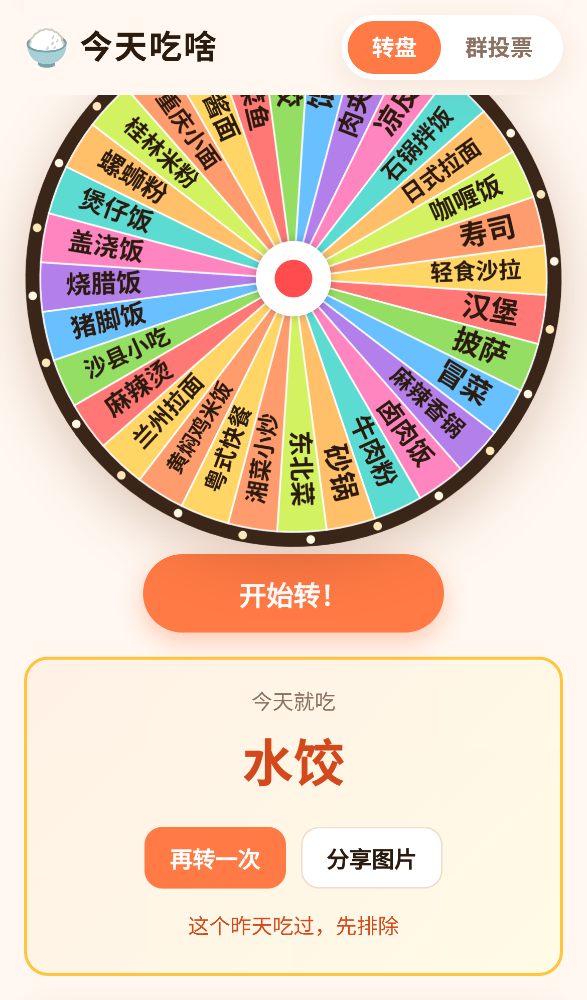
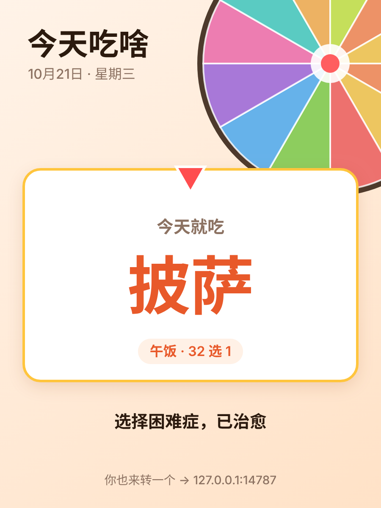
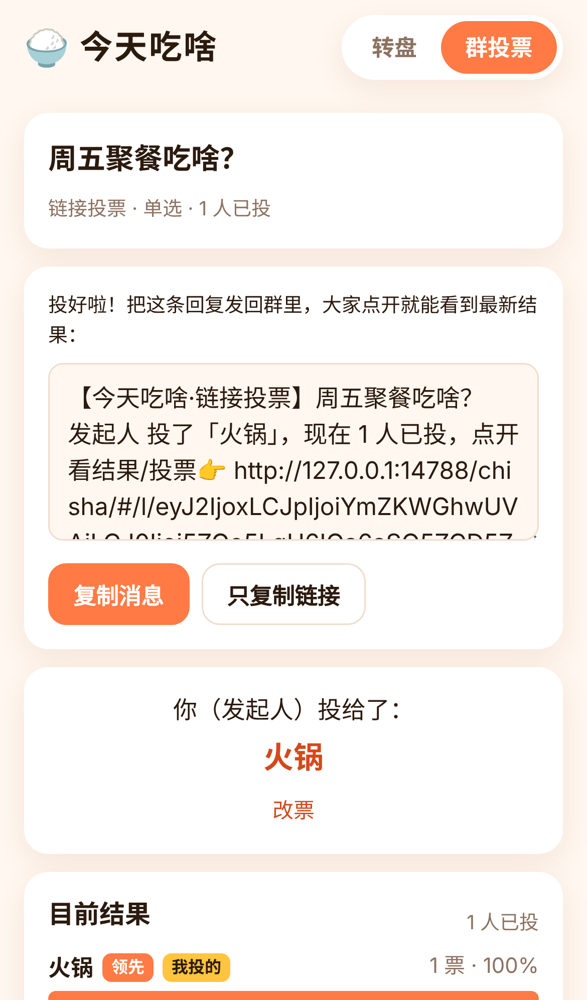

# 今天吃啥 🍚

<p align="center">
  
  
  
</p>

> 选择困难症救星：**转个转盘**，或者**发个群投票**，一秒决定今天吃什么。

**在线体验：<https://ash-ze.github.io/chisha/>**

一个开源、轻量、可离线使用的小网页应用。界面全中文，手机优先，零运行时依赖。

## 功能

### 模式一：转盘（完全离线可用，无需后端）

- 内置 12 套选项：**午饭 / 晚饭 / 外卖 / 做什么菜 / 早餐 / 夜宵 / 火锅店类型 / 奶茶 / 喝什么 / 甜品 / 轻食 / 周末去哪**，每套 18～32 个通用品类（不含品牌名）
- **自定义转盘**：自己起名、每行一个选项（最多 60 个），保存在本机浏览器
- Canvas 绘制：先快后慢的缓动 + "咔哒"音效（可关闭）+ 结果卡片
  - 转盘停下后，左半边的文字自动翻转成正着读
  - 每格单独挑字号：长名字先缩小，实在放不下才加省略号；40 个选项也看得清
- **喜欢的 ×2**：给更想吃的标 ♥，它在转盘上占两倍宽，被转到的概率也是两倍（概率和格子面积一致，所见即所得）
- **淘汰模式**：转到谁就淘汰谁，直到只剩最后一个
- **最近结果**：记录最近 10 次结果
- **分享图片**：一键生成 3:4 的结果卡片，微信里长按图片即可保存或发给朋友；支持系统分享的浏览器可直接分享
- **再转一次**；**这个昨天吃过** —— 把结果排除出转盘，点一下随时恢复
- 结果完全由代码随机决定，指针一定停在扇区内部，不会压线引起争议
- 一键「拿去群投票」：把当前转盘的选项带到投票表单
- PWA：可"添加到主屏幕"，首次打开后断网也能转

### 模式二：群投票

有两种方式，**没有部署后端时也能投**：

| | 链接投票（不需要服务器） | 实时群投票（需要部署 Worker） |
|---|---|---|
| 原理 | 题目和每个人的选择都编码在链接 `#/l/…` 里 | 数据存在 Cloudflare KV |
| 用法 | 每人投完把生成的新链接发回群里，**群里最新那条就是最新结果** | 大家打开同一个链接投票，结果每 3 秒自动刷新 |
| 同时投票 | 打开任何一条链接都会和本机看过的结果**自动合并**；也可以把几条群消息粘贴进来合并 | 天然支持 |
| 防重复 | 无（按昵称区分，适合熟人） | 每个浏览器一个匿名 ID，可改票 |
| 规模 | ≤ 20 个选项、≤ 40 人 | ≤ 30 个选项、≤ 300 人，可设截止时间，保留 7 天 |

- 没有配置后端时（比如只部署了 GitHub Pages），投票页会显示"实时群投票需要部署后端，见 README"，并直接提供链接投票，**不会发出任何 API 请求、不会报错**
- 配置了后端但暂时连不上时，给出提示，**转盘不受影响**

## 架构

```
┌──────────────────────────┐        ┌───────────────────────────────┐
│ 静态站（Vite 构建）        │  HTTPS │ Cloudflare Worker  (worker/)   │
│ GitHub Pages /            │ ─────▶ │  POST /api/polls               │
│ Cloudflare Pages / 任意静态 │  JSON  │  GET  /api/polls/:id           │
│                          │ (可选)  │  POST /api/polls/:id/vote      │
│ · 转盘：纯前端 + localStorage│        │  GET  /api/health              │
│ · 链接投票：纯前端          │        └──────────────┬────────────────┘
│ · Service Worker 离线缓存  │                       │
└──────────────────────────┘                       ▼
                                     Cloudflare KV（binding: POLLS）
                                     p:<id>            投票本体，TTL 7 天
                                     v:<id>:<voterId>  每人一条，metadata 存昵称+选择
                                     rl:<scope>:<ip>:<分钟> 轻量限流计数
```

- **前端**：原生 JavaScript + Vite，零运行时依赖。自写约 30 行的 Vite 插件在构建时生成 Service Worker（预缓存所有产物），不依赖 PWA 插件。
- **为什么用 KV 而不是 Durable Object**：每个投票人写自己的 key（`v:<投票ID>:<投票人ID>`），不存在多人同时改同一个 key 的写竞争；统计时用 `list({prefix})` 一次读出所有 key 的 metadata 聚合，不需要逐条读取。部署简单、免费额度够用。
- **链接投票**：payload = base64url(UTF-8 JSON)，包含投票编号、题目、选项和每票的 `[昵称, 选择, 时间]`。合并时按昵称去重、保留时间更新的那票。打开链接时所有字段都重新校验（长度、数量、下标范围），不信任链接内容。
- **安全**
  - 所有用户输入（标题、选项、昵称）在前端一律用 `textContent` 渲染，从不拼接 `innerHTML`，杜绝 XSS；服务端原样存储、返回 `application/json` + `nosniff`
  - 构建产物带 Content-Security-Policy（`<meta>`，因为 GitHub Pages 不能设置响应头）：只允许本站脚本，`connect-src` 只放行配置的 API 地址
  - 服务端校验：标题 ≤ 60 字、选项 2～30 个且每个 ≤ 30 字、昵称 ≤ 20 字、请求体 ≤ 8KB、截止时间不超过 7 天、单选投票不能多选、选项下标必须合法、每个投票最多 300 人；去掉控制字符、零宽字符和双向文本控制符
  - 轻量限流：同一 IP 每分钟最多创建 10 个投票、提交 30 次投票（基于 KV 计数，非严格原子，足以挡住随手刷票）
  - **CORS 白名单**：`ALLOWED_ORIGINS` 默认只有 `https://ash-ze.github.io`；未配置时不允许任何跨域来源。不在白名单里的浏览器请求直接返回 403（CORS 本身只能挡"读"，挡不住"写"）
  - 没有账号、没有密钥、不收集个人信息

### 目录结构

```
index.html            页面入口（Open Graph 标签；构建时注入 CSP）
src/
  main.js             路由（hash 路由：#/ 转盘，#/vote 发起投票，#/p/<id> 实时投票，#/l/<数据> 链接投票）
  wheelView.js        转盘页面（权重、淘汰、历史、分享）
  wheel.js            Canvas 转盘绘制、动画与音效
  labels.js           转盘文字排版：翻转、自动缩小（纯函数）
  pick.js             转盘选择逻辑：权重、淘汰（纯函数）
  shareCard.js        分享图片绘制
  data.js             内置选项集
  pollView.js         实时群投票页面 / 投票首页
  linkPoll.js         链接投票：编码、校验、合并、统计（纯函数）
  linkPollView.js     链接投票页面
  api.js / config.js  API 客户端（超时、离线判定、是否配置了后端）
  storage.js          localStorage 封装
  dom.js / bars.js / optionRows.js  DOM 帮手
  sw.js               Service Worker 模板
public/               图标、manifest、og.png
worker/
  wrangler.toml       Worker 配置（KV ID 为占位符）
  src/index.js        API 实现
test/                 单元测试（vitest，含内存版 KV 模拟）
e2e/e2e.mjs           端到端测试（Playwright）
scripts/              由 SVG 生成图标、生成 og.png
.github/workflows/    GitHub Pages 自动部署
screenshots/          手机尺寸截图（由 e2e 生成）
```

## 本地开发

需要 Node.js 20.19+ 或 22+。仓库里的 `.npmrc` 设置了 `legacy-peer-deps=true`（绕过开发依赖之间的 peer 依赖版本冲突），`npm install` / `npm ci` 和 GitHub Actions 都会自动读取，不用额外加参数。

```bash
npm install

# 只玩转盘 / 链接投票：一条就够了
npm run dev               # http://localhost:5173

# 想调试实时群投票，再开一个终端启动本地 Worker
# （wrangler 本地模式，用 miniflare 模拟 KV，不需要登录 Cloudflare；/api 会自动代理到 8787）
npm run dev:worker        # http://127.0.0.1:8787
```

### 测试

```bash
npm test          # 单元测试：转盘逻辑（权重/淘汰/文字排版）、链接投票、Worker 各接口（内存 KV 模拟）
npm run e2e       # 端到端：自动构建两份产物，启动 wrangler dev + vite preview + 一个普通静态服务器，
                  # 用手机尺寸的浏览器跑完转盘玩法 / 分享图 / 离线 / 实时投票 / XSS / 降级，
                  # 以及"GitHub Pages 无后端"场景下的友好提示和链接投票（接力、自动合并、粘贴合并）
```

端到端测试默认使用端口 18787（API）、14787（静态站）和 14788（模拟 GitHub Pages），可用 `E2E_API_PORT` / `E2E_WEB_PORT` / `E2E_PAGES_PORT` 修改。
如果 Playwright 的浏览器装在别处，设置 `PLAYWRIGHT_BROWSERS_PATH`；没装过可运行 `npx playwright install chromium`。截图会写到 `screenshots/`。

### 构建

```bash
npm run build                                              # 无后端（转盘 + 链接投票），产物在 dist/
VITE_API_BASE=https://你的-worker-地址 npm run build         # 带实时群投票
```

`VITE_API_BASE` 的取值：留空 = 没有后端；`/` = 同源的 `/api`；完整地址 = 跨域调用该 Worker。`vite.config.js` 中 `base: './'`，产物用相对路径，可以部署在任意子目录。`VITE_SITE_URL`（默认 `https://ash-ze.github.io/chisha/`）用于 Open Graph 分享卡片的绝对链接。见 [.env.example](.env.example)。

## 部署到 GitHub Pages

仓库自带 [`.github/workflows/pages.yml`](.github/workflows/pages.yml)：推送到 `main` 时自动 `npm ci` → `npm test` → `npm run build` → 发布 `dist/`。

1. 仓库 **Settings → Pages → Build and deployment → Source** 选 **GitHub Actions**
2. 推送到 `main`（或在 Actions 页手动运行 "Deploy to GitHub Pages"）
3. 打开 `https://<用户名>.github.io/<仓库名>/`

因为使用 hash 路由和相对路径，放在子路径下也能正常工作，不需要 404 重定向。此时转盘和链接投票都可用，实时群投票会显示部署提示。

如果你的站点地址不是 `https://ash-ze.github.io/chisha/`，在 **Settings → Secrets and variables → Actions → Variables** 里新建变量 `VITE_SITE_URL`（例如 `https://你的用户名.github.io/chisha/`），让分享卡片的链接正确。

## 部署投票后端（可选）

想要实时群投票（结果自动刷新、可设截止时间、防重复投票），需要部署 `worker/` 里的 Cloudflare Worker。以下步骤需要你自己的 Cloudflare 账号（免费套餐足够），本仓库不包含任何密钥。

### 1. 部署 Worker

```bash
npx wrangler login
npx wrangler kv namespace create POLLS
npx wrangler kv namespace create POLLS --preview
```

把输出的 `id` 和 `preview_id` 填进 `worker/wrangler.toml`，并把 `ALLOWED_ORIGINS` 改成**你的静态站来源**（协议 + 域名，不带路径，多个用逗号分隔）：

```toml
[vars]
ALLOWED_ORIGINS = "https://你的用户名.github.io"
```

```bash
npx wrangler deploy --config worker/wrangler.toml
```

记下得到的地址，比如 `https://chisha-api.<你的子域>.workers.dev`。可以用 `curl https://chisha-api.<你的子域>.workers.dev/api/health` 确认返回 `{"ok":true,...}`。

### 2. 用 VITE_API_BASE 重新构建前端

**GitHub Pages（推荐）**：在仓库 **Settings → Secrets and variables → Actions → Variables** 新建变量（不是 Secret，这个地址本来就是公开的）：

```
VITE_API_BASE = https://chisha-api.<你的子域>.workers.dev
```

然后在 Actions 页重新运行 "Deploy to GitHub Pages"。投票页的部署提示会消失，变成"实时投票 / 链接投票"两个选项。

**手动构建**：

```bash
VITE_API_BASE=https://chisha-api.<你的子域>.workers.dev npm run build
# 把 dist/ 发布到任意静态托管
```

**Cloudflare Pages**：构建命令 `npm run build`，输出目录 `dist`，环境变量 `VITE_API_BASE` 同上。也可以给 Worker 绑定和静态站同域名的路由 `example.com/api/*`，这时设 `VITE_API_BASE=/`，不需要 CORS。

## 已知限制

- 链接投票没有服务器校验：任何人都能改链接、换昵称重复投票；两人同时投时最新那条链接可能缺票（打开所有链接或粘贴合并即可补齐）。链接里包含所有昵称和选择，转发给谁谁就能看到。
- Cloudflare KV 是最终一致的：不同地区的朋友之间，实时投票结果可能延迟几秒到一分钟才同步（同一人自己的投票会立即显示）。如果需要强一致，可以把存储换成 Durable Object。
- 限流基于 KV 计数，非原子，只能挡住明显的刷量。
- 匿名身份存在浏览器里：换设备或清除浏览器数据后会被当成新的投票人；有心人也可以用多个浏览器重复投票——这是个吃饭小工具，不是选举系统。
- 自定义转盘、喜欢的选项、最近结果只保存在当前设备，不会同步。

## 许可证

[MIT](LICENSE) © 今天吃啥 contributors
